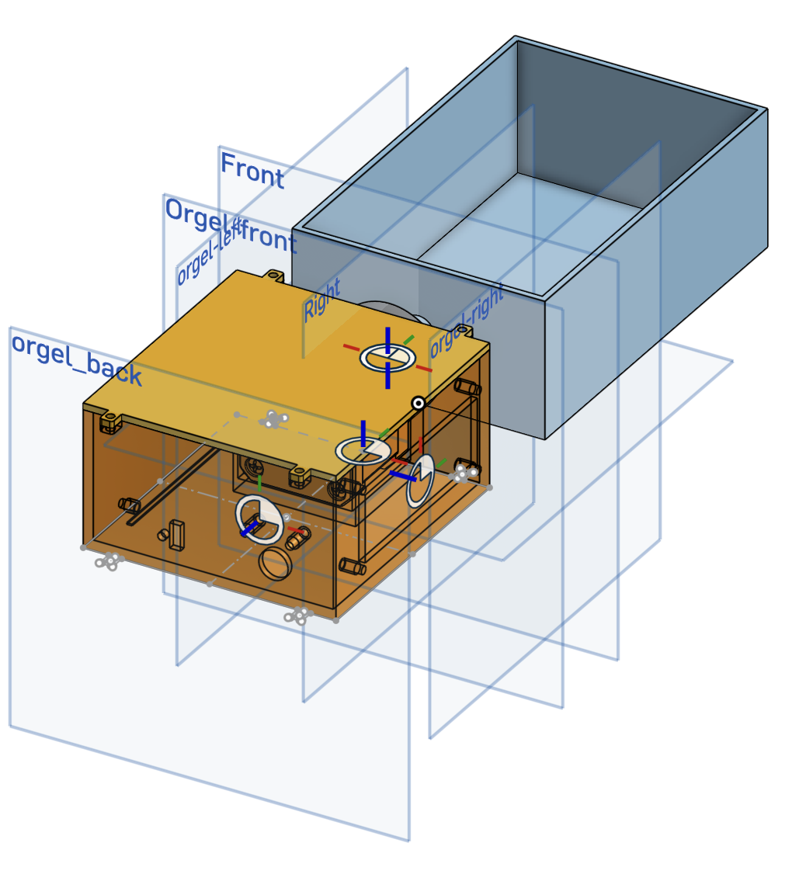
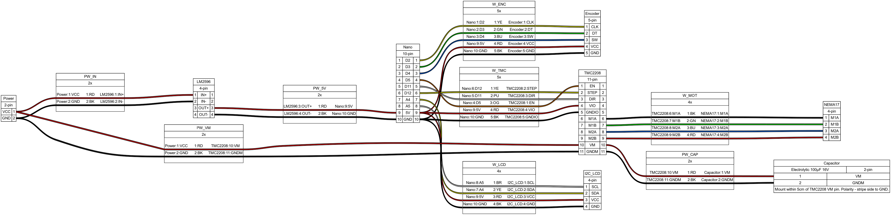

AutoOrgel
=========

A module that rotates crank handle of manual paper orgel player, making it play song chart by itself.

Consists of the following modules:

* Arduino: The code that is drives main arduino chip.
* Circuit: Describes the components that is used for and the connection between them.
* Model: The auto-orgel player box and all necessary models for playing.

### Preview of the model

### Preview of the circuit

